<div align="center">



<p>
  <a href="https://cyberloop-dev.github.io/botgrid/"></a>
  
  
</p>

**A tiny robotics-flavored playground for the algorithms behind real path planning.**

</div>

---

## ✨ Features

- 🧱 **Draw walls** by dragging; click a wall to erase it
- 🟢🔴 **Drag the start and goal** anywhere
- 🧭 **Four algorithms**, side by side in behavior: A\*, Dijkstra, Breadth-first, Greedy best-first
- ↗️ Optional **diagonal moves** (no corner cutting)
- 🤖 A little **robot drives the route** once it is found
- 📊 Live stats: cells explored, path length, result
- 🎲 One-click random obstacles
- 📱 Works with mouse and touch

## 🚀 Quick start

Open the [live demo](https://cyberloop-dev.github.io/botgrid/), or:

```bash
git clone https://github.com/CyberLoop-dev/botgrid.git
cd botgrid
open index.html
```

## 🧠 What to look for

| Algorithm | Shortest path? | Explores | Good for |
|---|---|---|---|
| **A\*** | Yes | Least (with a good heuristic) | Most real planners |
| **Dijkstra** | Yes | A lot, in every direction | Weighted maps, no heuristic |
| **Breadth-first** | Yes (equal steps) | A lot | Unweighted grids |
| **Greedy best-first** | Not guaranteed | Very little | Fast and rough |

Try a U-shaped wall between start and goal: greedy walks straight into the trap, A\* does not.

## 📄 License

MIT
